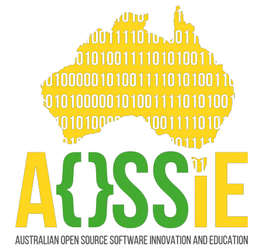
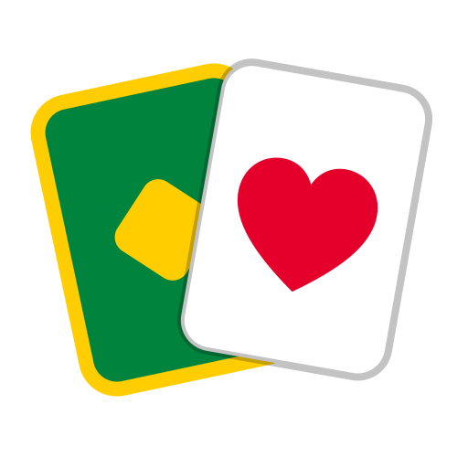
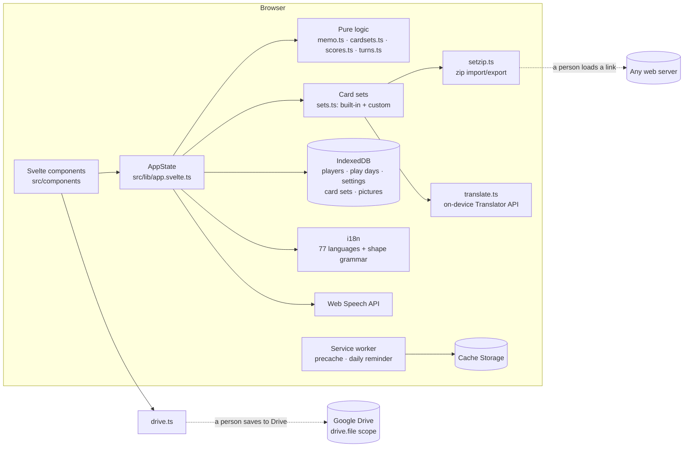
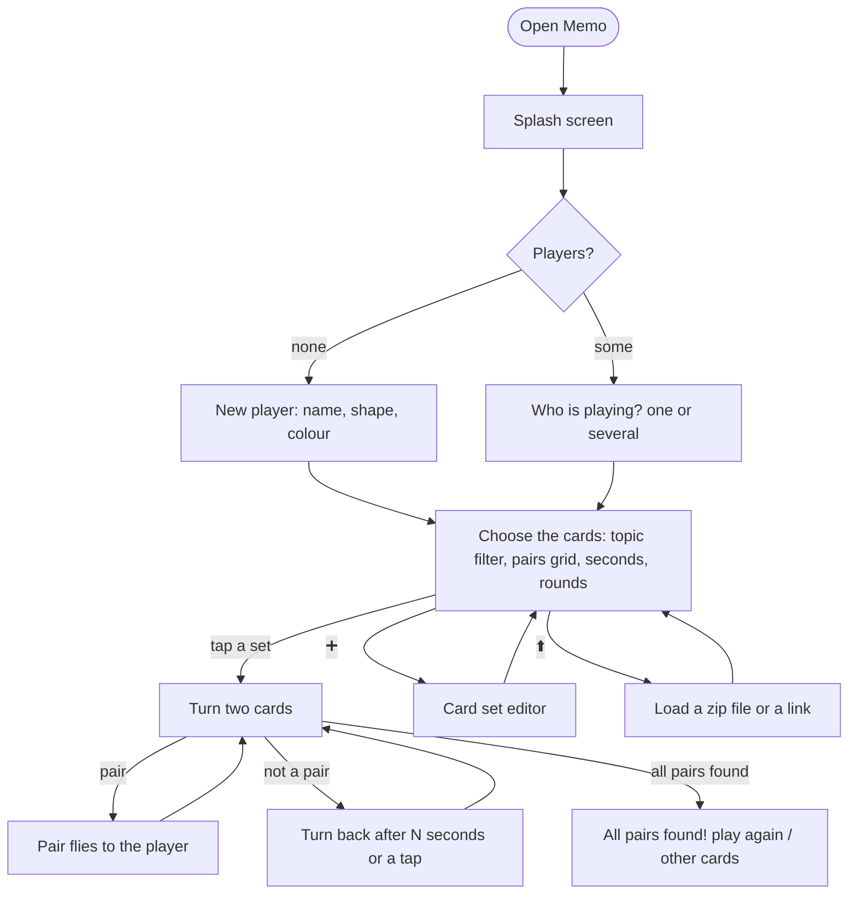
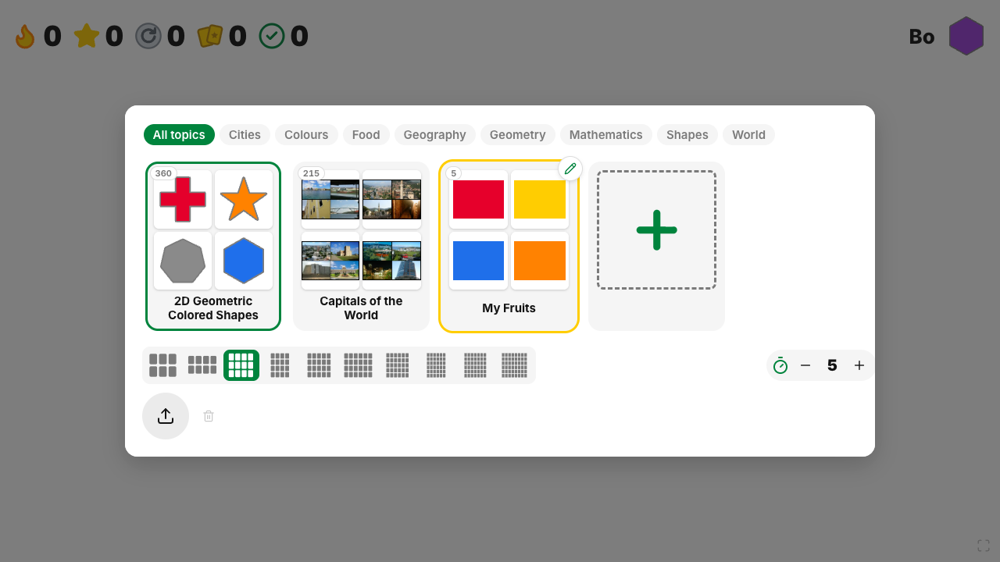
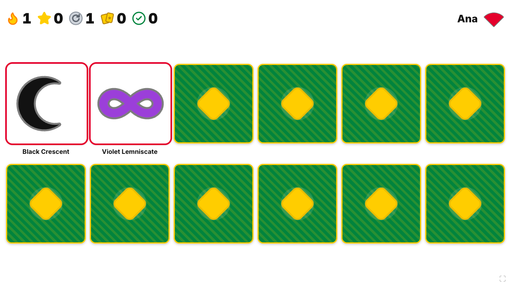
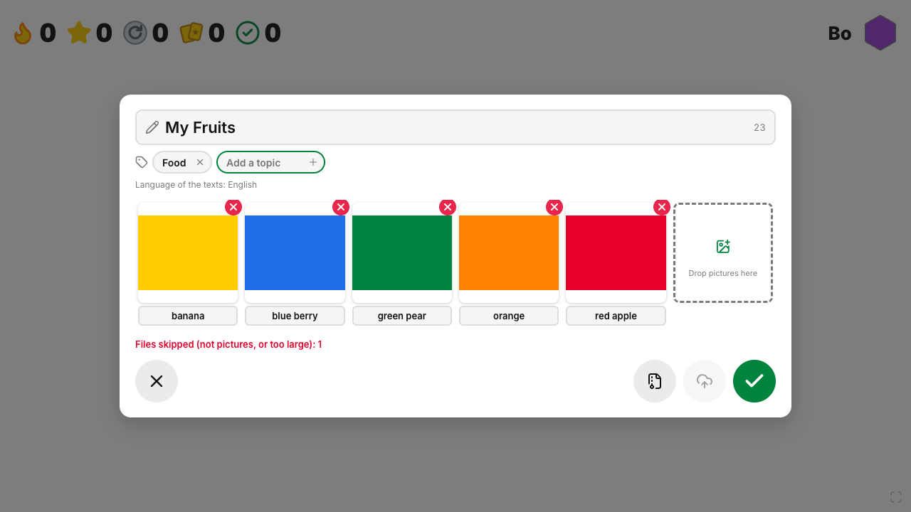
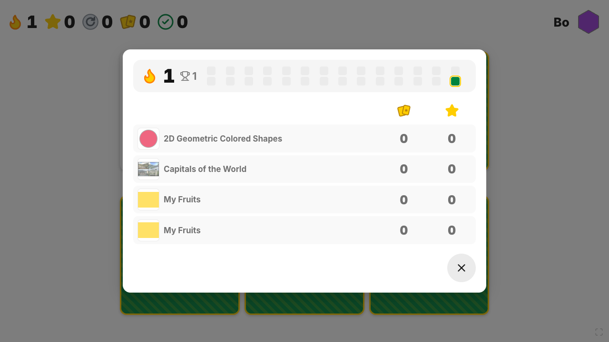
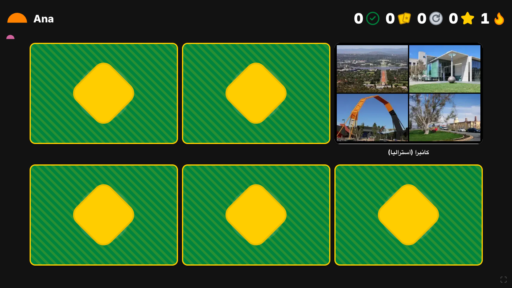
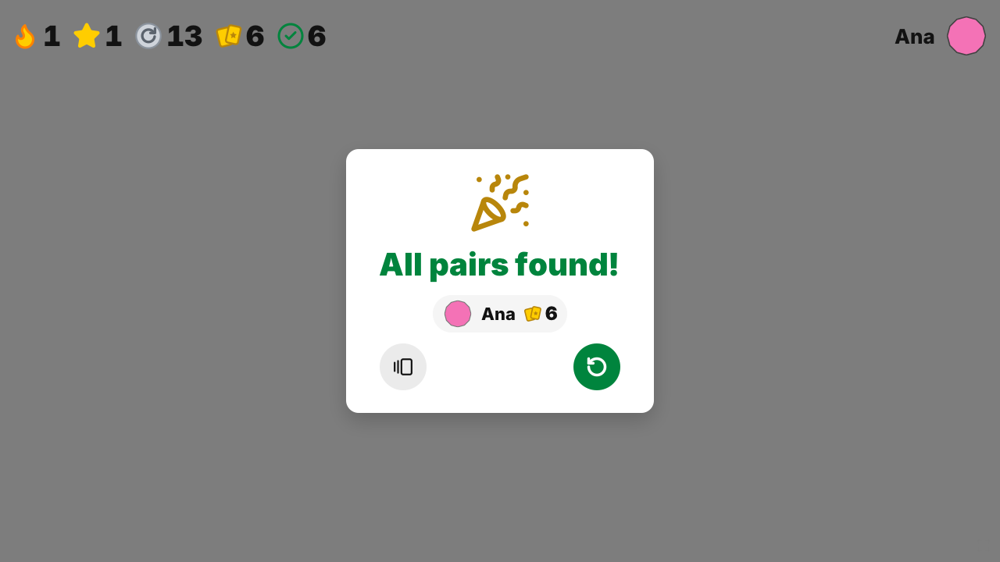

<!-- Don't delete it -->
<div name="readme-top"></div>

<!-- Organization Logo -->
<div align="center" style="display: flex; align-items: center; justify-content: center; gap: 16px;">
  
  
</div>

&nbsp;

<!-- Organization Name -->
<div align="center">

[](https://edumemo.aossie.org/)

<!-- Correct deployed url to be added -->

</div>

<!-- Organization/Project Social Handles -->
<p align="center">
<!-- Telegram -->
<a href="https://t.me/+bMWGzaMTMa8xN2Ex">
</a>
&nbsp;&nbsp;
<!-- X (formerly Twitter) -->
<a href="https://x.com/aossie_org">
</a>
&nbsp;&nbsp;
<!-- Discord -->
<a href="https://discord.gg/hjUhu33uAn">
</a>
&nbsp;&nbsp;
<!-- LinkedIn -->
<a href="https://www.linkedin.com/company/aossie/">
  </a>
&nbsp;&nbsp;
<!-- Youtube -->
<a href="https://www.youtube.com/@AOSSIE-Org">
  </a>
</p>


<p align="center">
  <a href="https://scorecard.dev/viewer/?uri=github.com/AOSSIE-Org/Memo-EducationalGame">
    </a>
  &nbsp;&nbsp;
  <a href="./BestPracticesChecklist.md">
    </a>
  &nbsp;&nbsp;
  <a href="https://github.com/gitleaks/gitleaks">
    </a>
</p>

---


<div align="center">
<h1>Memo</h1>
</div>

[Memo](https://edumemo.aossie.org/) is a memory card game for children, based on the classic game of pairs: the cards lie face down, and each round the child turns two of them, trying to find the pairs. Every card has a picture and a description, which is shown under the card and read aloud when the card is turned, so children learn while they play: coloured geometric shapes, the capitals of the world, or any cards that parents and teachers make themselves. It is a sister app of [Flag Quiz](https://github.com/AOSSIE-Org/FlagQuiz), with the same look, the same icons and most of its code, and like it, it is purely local: no accounts, no ads, no tracking, and it works offline.

---

## 🚀 Features

- **The game of pairs**: tap a card and it turns over (3D flip), its description appears under it and is read aloud. Two cards that match fly to the player's avatar in the top right corner, shrinking until they disappear; two cards that don't match stay face up until a set number of seconds has passed (5 by default) or until the player taps anywhere, then turn back with the same animation.
- **Card sets with topics**: a card set has a name, topics and cards (picture + description). The card set picker shows four random cards of each set, filters by topic, and starts a game with one tap.
- **Built-in card sets**:
  - **2D Geometric Colored Shapes** — 30 shapes (circle, equilateral/isosceles/scalene/right triangle, square, rectangle, rhombus, parallelogram, trapezium, pentagon to decagon, dodecagon, pentadecagon, icosagon, star, crescent, cross, heart, ellipse, ring, semicircle, circle sector, lemniscate, trefoil, quatrefoil) × 12 colours (the 7 rainbow colours plus black, grey, white, brown and pink) = 360 cards, described as e.g. "Red Circle".
  - **Capitals of the World** — 215 capitals, each card showing the capital's 4 photos from Flag Quiz in one picture with a black frame and thin black lines between the photos, described as e.g. "Paris (France)".
  - **Country Flags** — the 234 flags of Flag Quiz, described by the country's name.
  - **Photo sets** — Common Fruits (27), Rare Fruits (27), Minerals (30), Insects (24), Mammals (34), Birds (27), Farm Animals (17), Reptiles (20), Fish (24) and Amphibians (19): photos from Wikimedia Commons, found through the English Wikipedia articles and their Wikidata items (`npm run fetch-photo-sets`); every photo was reviewed, and 18 were replaced by hand (fruits shown as trees or flowers, cut-off subjects, an engraving) in [`scripts/photo-choices.json`](scripts/photo-choices.json). Names come from Wikidata in every language, with child-friendly names (no scientific names) added by hand where Wikidata has none ([`src/locales/cards-extra/`](src/locales/cards-extra/)).
  - **Letters of the Alphabet** (A–Z), **Letters of the Cyrillic Alphabet** (the 33 letters of the Russian alphabet, read aloud with a Russian voice) and **Numbers from 0 to 9** (each digit with as many dots, described by the number's word in the app's language), drawn by [`src/lib/symbols.ts`](src/lib/symbols.ts) (`npm run build-symbols`).
- **Game settings**, chosen with icons in the card set picker: the number of pairs as **grid icons** (3, 4, 6, 8, 10, 12, 15, 18, 21 or 24 pairs — grids that fill a landscape screen), the **seconds** two different cards stay face up (default 5), and in multiplayer the **maximum rounds in a row** a player keeps playing while finding pairs (default 3).
- **Make your own card sets**: the card set editor takes a name, up to 5 topics, and pictures — chosen or dragged and dropped **several at once** — with descriptions pre-filled from the file names. Length limits (name 32, topic 20, description 40 characters) keep every text readable on tiles and under cards. Sets can be **saved as a zip file** (a `cardset.json` and the pictures), **saved to the player's own Google Drive**, and **loaded from a zip file or a link**. Custom sets get a unique local id, so sets with the same name never clash, and have a small ✏️ button to edit them and a discreet, grown-ups-only 🗑 to delete them.
- **Players**: each player has a name and an avatar — one of the 30 shapes in a colour of their choice. One or several players on one device; in multiplayer, the turn passes after two different cards or after the maximum rounds in a row, with a banner announcing the next player.
- **Scores** (top left, as in Flag Quiz): 🔥 days in a row; ⭐ games finished with the current card set; a silver round counter (rounds in the current game); a gold "two cards" icon (pairs found with the current card set); ✅ pairs found with all card sets.
- **Statistics**: the streak and a 4-week calendar, and a table with one row per card set (pairs found, games finished), most pairs first. The table scrolls on its own, with its header fixed, because there can be any number of card sets; the streak stays at the top.
- **77 languages**, including right-to-left ones (Arabic, Persian, Pashto, Urdu, Hebrew): the whole interface, the names of the built-in sets, their topics and all card descriptions, with the grammar of each language (e.g. "Étoile Rouge", "Rotes Herz", "دائرة حمراء").
- **Custom card sets in every language**: texts are written in the app's current language; other languages are filled in by the browser's on-device translator where available (see below). Texts without a translation are shown, and read aloud, in the language they were written in.
- Everything else from Flag Quiz: read-aloud with local voices, sound effects, light and dark mode, offline PWA with an update button, daily reminder, export/import of players and backups, grown-ups-only deletion, share, credits and donation page, full-screen button.

### Translating custom card sets: the options

People write a card set's name, topics and descriptions in the app's language. To show them in the other 76 languages, these options were considered:

| Option | Privacy | Offline | Quality | Effort for the author |
|---|---|---|---|---|
| **A. On-device machine translation with the browser's Translator API** (Chrome 138+; models run on the device) | ✅ texts never leave the device | ✅ once the language model is downloaded | good | none |
| B. A cloud translation service (Google Cloud Translation, DeepL, LibreTranslate…) | ❌ texts sent to a third party; needs an API key or server | ❌ | very good | none |
| C. A translation model bundled with the app (e.g. Bergamot/Firefox Translations, NLLB via transformers.js) | ✅ | ✅ | good | none, but tens to hundreds of MB per language pair to download |
| D. Manual translations: the author switches the app's language and edits the set again | ✅ | ✅ | best | high (one pass per language) |
| E. No translation: show the original text in every language, read aloud with a voice of its own language | ✅ | ✅ | — | none |
| F. Ask for translations when sharing (zip files carry every language; a native speaker adds theirs and passes it on) | ✅ | ✅ | best | spread among the community |

**Implemented (recommended): A + D + E + F together.** Each text is stored per language with the language it was written in. When the app's language changes, the app translates missing texts on the device with the Translator API, where the browser has it, and marks those languages as automatic. Anyone can correct a translation by switching to that language and editing the set (D); editing a text drops the now-outdated automatic translations of it but keeps translations written by people. Without the API, texts are shown and read aloud in their own language (E). Zip files carry all languages and which ones were machine-translated (F). Option B was rejected because it would send children's and teachers' texts to a third party and need a server or key; option C because of its size.

### Saving card sets to Google Drive

Following Google's recommendations for apps that run only in the browser: [Google Identity Services](https://developers.google.com/identity/oauth2/web/guides/use-token-model) **token model** (a sign-in popup, no client secret, no redirect, no refresh token), the narrowest scope **`drive.file`** (the app can only see the files it creates; it's a non-sensitive scope), the access token kept **in memory only** and **revoked** right after the upload, and Google's script loaded **only** when the card set editor opens. To enable it in a deployment:

1. In [Google Cloud Console](https://console.cloud.google.com/), enable the Google Drive API and create an OAuth client ID of type **Web application**, with the app's origin (e.g. `https://edumemo.aossie.org`, and `http://localhost:5173` for development) under *Authorized JavaScript origins*. Configure the OAuth consent screen with the `drive.file` scope.
2. Build with the client ID: `VITE_GOOGLE_CLIENT_ID=<id>.apps.googleusercontent.com npm run build` (for the GitHub Pages workflow, as a repository variable passed to the build step). A client ID is public by design; there is no secret.

Without a client ID, the Drive button is shown faded and says that saving to Google Drive is not set up.

### The card set zip format

```jsonc
// cardset.json, next to the pictures
{
  "format": "memo-card-set",
  "version": 1,
  "language": "en",                                   // language the texts were written in
  "name": { "en": "Fruits", "fr": "Fruits" },          // or just "Fruits"
  "tags": [{ "en": "Food", "fr": "Nourriture" }],      // or ["Food"]
  "cards": [{ "image": "images/001.webp", "description": { "en": "Apple" } }],
  "autoTranslated": ["fr"]                             // optional
}
```

Loaded files are untrusted: zip files are limited in size before they are unpacked, every field is validated, texts are cleaned and cut to the editor's limits, pictures are recognised by their content and re-encoded by the app (which turns SVG files into plain pictures and removes metadata such as GPS positions), and the set gets a new local id.

---

## 💻 Tech Stack

### Frontend
- [Svelte 5](https://svelte.dev/) (runes) + TypeScript, built with [Vite](https://vite.dev/)
- [Lucide](https://lucide.dev/) icons, [Inter](https://rsms.me/inter/) (bundled)
- [vite-plugin-pwa](https://vite-pwa-org.netlify.app/) (Workbox) for offline use and installation
- [fflate](https://github.com/101arrowz/fflate) for zip files

### Browser APIs
- IndexedDB (via [idb](https://github.com/jakearchibald/idb)) for players, card sets and their pictures
- Web Speech API (text-to-speech), Web Audio API (sound effects), Web Animations API (flying pairs)
- Translator API (on-device translation, where available), Google Identity Services + Drive API v3 (only when saving to Drive)

### Data
- Shapes: drawn by [`src/lib/shapes.ts`](src/lib/shapes.ts) (`npm run build-shapes` writes the 360 SVG cards; the avatars use the same code)
- Capitals: data and photos from Flag Quiz ([`src/data/capitals.ts`](src/data/capitals.ts)); `npm run build-capitals` combines each capital's 4 photos into one card
- Names of countries and capitals in every language: from Flag Quiz (Unicode CLDR and Wikidata)

### Testing
- [Vitest](https://vitest.dev/) with [fake-indexeddb](https://github.com/dumbmatter/fakeIndexedDB): game logic, layout, scores, translations (every key, placeholder, shape and colour in every language), card set zip files, player files, the database and the compatibility of saved data
- [Playwright](https://playwright.dev/) (playwright-core) in Chrome and WebKit for end-to-end checks

---

## ✅ Project Checklist

- [x] **The web app**:
   - [x] uses the colours and typeface of the [AOSSIE brand guidelines](https://github.com/AOSSIE-Org/Info/blob/main/Brand.md).
   - [x] has metadata for sharing on social media (Open Graph, X/Twitter cards).
   - [x] works offline and can be installed as a PWA.
   - [x] stores all data locally (IndexedDB); it only contacts other services when a person loads a card set from a link or saves one to their Google Drive.
   - [x] fits on one screen on desktop and on phones in landscape.
   - [x] is deployed to [edumemo.aossie.org](https://edumemo.aossie.org/).

---

## 🔗 Repository Links

1. [Main Repository](https://github.com/AOSSIE-Org/Memo-EducationalGame) (the frontend is the whole app; there is no backend)

---

## 🏗️ Architecture Diagram



---

## 🔄 User Flow



### Key User Journeys

1. **A child plays alone**: picks their avatar, taps a card set, turns cards; descriptions are shown and read aloud; finished games add a gold star for that set.
2. **Several children play together**: 👥 in the player picker, select players, choose the maximum rounds in a row; the turn passes after a mistake or after that many pairs in a row.
3. **A teacher makes a card set**: ➕ in the card set picker, name and topics, drops a folder of pictures, corrects the descriptions, saves; then saves it as a zip or to Google Drive to share it, and another device loads it from the file or a link.

---

## 🍀 Getting Started

### Prerequisites

- Node.js 22.18 or newer (the generator scripts run TypeScript directly), npm

### Installation

```bash
git clone https://github.com/AOSSIE-Org/Memo-EducationalGame.git
cd Memo-EducationalGame
npm install
npm run dev
```

Then open http://localhost:5173.

### Other Commands

```bash
npm run check           # type-check (svelte-check)
npm test                # unit tests
npm run build           # production build in dist/ (works from any folder of any static host)
npm run preview         # serve the build
npm run build-shapes    # regenerate public/cards/shapes/ from src/lib/shapes.ts
npm run build-capitals  # regenerate public/cards/capitals/ from Flag Quiz's photos (FLAGQUIZ_DIR=… to use a local checkout)
npm run build-symbols   # regenerate the letter and number cards
npm run fetch-photo-sets # download the photo sets' photos, credits and names (Wikipedia, Wikidata, Commons)
npm run build-credits   # regenerate public/credits.html and its translations
```

### Deployment

Every push to `main` runs the [deploy workflow](.github/workflows/deploy.yml) (type-check, tests, build, GitHub Pages). `dist/` can be served by any static host.

---

## 📱 App Screenshots

| | |
|---|---|
|  |  |
| Choose the cards: topics, pairs, seconds | Two different cards, with their descriptions |
|  |  |
| Card set editor | Statistics |
|  |  |
| Capitals of the World in Arabic, dark mode | All pairs found |

---

## 🙌 Contributing

⭐ Don't forget to star this repository if you find it useful! ⭐

Thank you for considering contributing to this project! Contributions are highly appreciated and welcomed. To ensure smooth collaboration, please refer to our [Contribution Guidelines](./CONTRIBUTING.md).

**Translations**: the interface texts are in [`src/locales/`](src/locales/), one file per language, with English ([`en.ts`](src/locales/en.ts)) as the reference; names of shapes and colours, and how they combine into card descriptions ("Red Circle", "Cercle Rouge", "Roter Kreis"), are in [`src/locales/shapes/`](src/locales/shapes/) (see [`src/lib/shapeNames.ts`](src/lib/shapeNames.ts)). All non-English translations were written with an AI assistant, so corrections from native speakers are very welcome — especially the rare geometry terms (lemniscate, trefoil, quatrefoil, circle sector, pentadecagon, icosagon) and Amharic, Lao, Khmer, Burmese, Somali, Zulu, Swahili, Sundanese, Irish and Welsh. `npm test` checks that every message, placeholder, shape and colour is there in every language.

---

## 🔐 Security

Please report vulnerabilities privately, as described in [SECURITY.md](./SECURITY.md).

---

## ✨ Maintainers

See [MAINTAINERS.md](./MAINTAINERS.md) for maintainers, mentors, and ideators.

---

## 📍 License

This project is licensed under the GNU General Public License v3.0.
See the [LICENSE](LICENSE) file for details.

The pictures of shapes are drawn by the app's own code ([`src/lib/shapes.ts`](src/lib/shapes.ts)) and are under the same licence as the app. The capitals, their names and their photos come from [Flag Quiz](https://github.com/AOSSIE-Org/FlagQuiz) (capitals from Wikidata, CC0; country names from the Unicode CLDR; photos from Wikimedia Commons under their own free licences, mostly CC BY and CC BY-SA). Each photo's author, licence and source are listed in [`public/credits.html`](public/credits.html) and in `src/data/capitals.ts`. The AOSSIE logo is used according to the [AOSSIE brand guidelines](https://github.com/AOSSIE-Org/Info/blob/main/Brand.md).

---

## 💪 Thanks To All Contributors

Thanks a lot for spending your time helping Memo grow. Keep rocking 🥂

[](https://github.com/AOSSIE-Org/Memo-EducationalGame/graphs/contributors)

© 2026 AOSSIE
